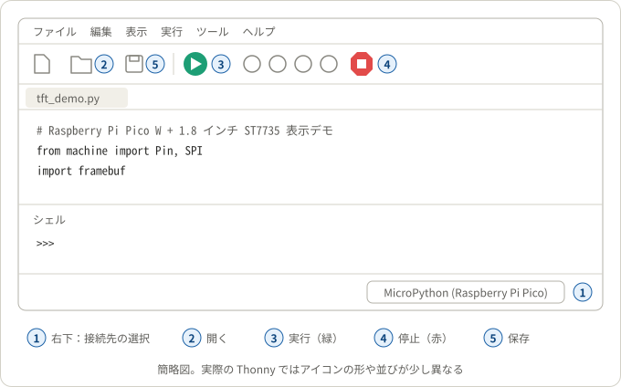
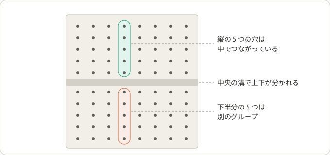
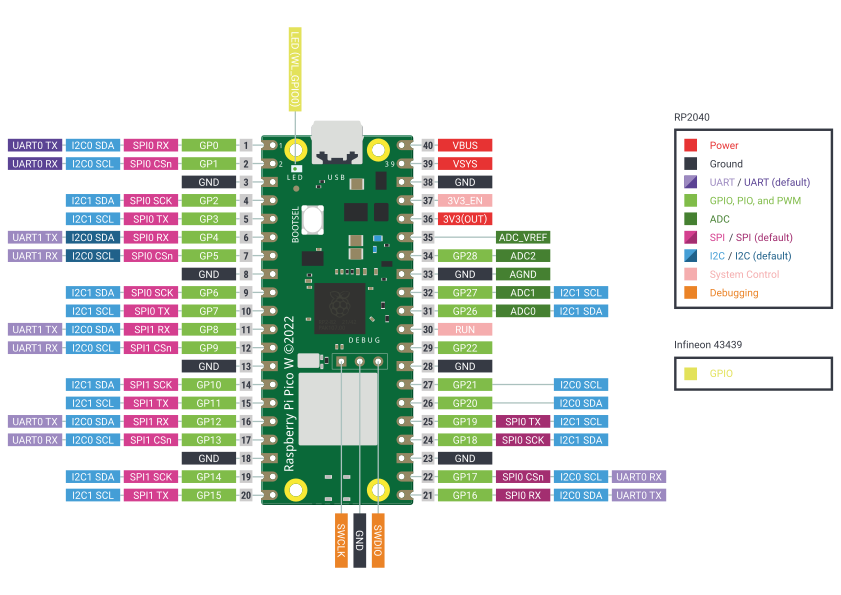

# picow

Raspberry Pi Pico W で電子部品を動かすためのコードと手順。部品ごとにディレクトリを分け、その中にプロジェクトを置く。

## 部品とプロジェクト

| 部品 | プロジェクト |
|---|---|
| [st7735](st7735/)：1.8 インチ TFT 液晶 | [project1](st7735/project1/)：表示デモ<br>[project2](st7735/project2/)：PC 画面のミラー表示 |
| [lcd1602](lcd1602/)：I2C 接続の 16 文字 × 2 行の液晶 | [project1](lcd1602/project1/)：Wi-Fi で時刻を合わせる時計<br>[project2](lcd1602/project2/)：OpenWeatherMap の天気表示 |

初めての場合は、このページの「[Pico W の準備](#pico-w-の準備)」を済ませてから、部品のディレクトリの README で配線し、プロジェクトの README の手順で動かす。

## ディレクトリ構成

README は階層ごとに役割を分けている。

```
picow/
├── README.md          # Pico W 共通の準備（このファイル）
├── images/            # このファイルの図
├── st7735/
│   ├── README.md      # ST7735 液晶の部品と配線
│   ├── images/        # 配線図
│   ├── project1/      # 表示デモ
│   │   └── README.md  # プロジェクトの使い方
│   └── project2/      # PC 画面のミラー表示
│       └── README.md
└── lcd1602/           # I2C LCD1602 液晶（構成は st7735/ と同じ）
```

## Pico W の準備

どの部品を使う場合でも共通の手順。1 から 2 は、初めて使うときに 1 回だけ行う。

### 1. Thonny をインストールする

Thonny は、Pico W にプログラムを書き込んで実行するためのエディタである。[thonny.org](https://thonny.org/) からダウンロードしてインストールする。画面写真付きの手順は、SunFounder Kepler Kit の解説「[1.2 Thonny IDE をインストール](https://docs.sunfounder.com/projects/kepler-kit/ja/latest/pyproject/python_start/install_thonny.html)」にある。

### 2. Pico W に MicroPython を書き込む

1. Thonny を開く。
2. Pico W の BOOTSEL ボタン（USB 端子の近くにある白いボタン）を押しながら、USB ケーブルで PC につなぐ。PC に RPI-RP2 という名前のドライブが現れたら、ボタンを離す。
3. Thonny の右下（下の図の①）をクリックし、「MicroPython をインストール」を選ぶ。
4. 「MicroPython のバリアント」で Pico W 用（Pico W / Pico WH）を選び、「インストール」を押す。終わったら画面を閉じる。

画面写真付きの手順は、「[1.3 Raspberry Pi Pico に MicroPython をインストール](https://docs.sunfounder.com/projects/kepler-kit/ja/latest/pyproject/python_start/install_micropython_to_pico.html)」にある。

### 3. Thonny の使い方



| 番号 | 場所 | 使い方 |
|---|---|---|
| ① | 右下 | 接続先を選ぶ。Pico W をつないだら「MicroPython (Raspberry Pi Pico)」を選ぶ |
| ② | 開く | PC にある `.py` ファイルを開く |
| ③ | 実行（緑） | 開いているファイルを Pico W で実行する（F5） |
| ④ | 停止（赤） | 実行を止める |
| ⑤ | 保存 | 開いているファイルを保存する |

Pico W に保存するには、「ファイル」→「名前を付けて保存」で保存先に「Raspberry Pi Pico」を選ぶ。`main.py` という名前で保存したファイルは、Pico W の電源を入れるたびに自動で実行される。

### 4. ブレッドボードに Pico W を差す



ブレッドボードは、縦に並んだ 5 つの穴が中でつながっている。中央の溝で上下は分かれる。Pico W を中央の溝をまたぐように差すと、各ピンが別々の縦の列につながる。その列の空いた穴にワイヤーを差せば、そのピンにつながる。

このリポジトリの配線図と配線表は、どれも次の向きと番号で書いている。

- Pico W は、USB 端子を左、部品面（チップやボタンがある面）を上にして差す。
- ピンは物理ピン番号（1〜40）で示す。配線図では、Pico W の基板の内側に各ピンの番号を書いている。番号とピンの名前の対応は「[Pico W のピン](#pico-w-のピン)」にまとめた。

配線は、USB ケーブルを抜いた状態で行う。

## Pico W のピン



図：Raspberry Pi Ltd「Pico W pinout」（[raspberrypi/documentation](https://github.com/raspberrypi/documentation/blob/master/documentation/asciidoc/microcontrollers/pico-series/images/picow-pinout.svg)）、[CC BY-SA 4.0](https://creativecommons.org/licenses/by-sa/4.0/)。

各ピンの横の灰色の枠の数字が物理ピン番号、色の付いた枠がそのピンで使える機能である。この図は USB 端子が上なので、反時計回りに 90 度回すと、このリポジトリの配線図と同じ向き（USB 端子が左）になる。そのとき、物理ピン番号は下側の列が左から 1〜20、上側の列が右から 21〜40 と並ぶ。

- プログラムでは、物理ピン番号ではなく GP の後の番号を使う。例えば、9 番ピン（GP6）は `Pin(6)` と書く。
- I2C と SPI は、図の組み合わせのピンでだけ使える。例えば `I2C(1, ...)` の SDA には、図で「I2C1 SDA」とあるピン（GP2、GP6、GP10 など）を使う。
- SPI の TX は、部品側の SDA（MOSI）につなぐピンである。

GP の付かないピンの役割は次のとおり。各ピンの説明は、キットの解説の [Pico W のページ](https://docs.sunfounder.com/projects/kepler-kit/ja/latest/introduction_to_pico_w.html) にもある。

| 名前 | 物理ピン番号 | 役割 |
|---|---|---|
| VBUS | 40 | USB から受け取った 5 V が出る |
| VSYS | 39 | Pico W の電源の入力（1.8〜5.5 V）。USB を使わずに電池などで動かすときにつなぐ |
| 3V3(OUT) | 36 | 3.3 V の出力。部品の電源に使う |
| 3V3_EN | 37 | GND につなぐと 3.3 V の電源が止まり、Pico W も止まる |
| ADC_VREF | 35 | ADC（アナログ入力）の基準電圧 |
| AGND | 33 | ADC 用のグラウンド |
| RUN | 30 | GND につなぐと Pico W がリセットされる |
| GND | 3、8、13、18、23、28、38 | グラウンド（0 V）。どれを使ってもよい |
