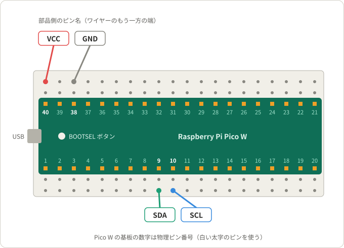
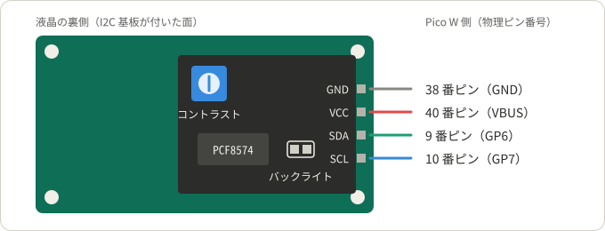

# I2C LCD1602 液晶（16 文字 × 2 行）

16 文字 × 2 行の文字を表示する液晶モジュールを、I2C で Raspberry Pi Pico W につなぐ。I2C は、2 本の信号線（SDA と SCL）で部品と通信する方式である。このディレクトリのプロジェクトは、すべてこのページの配線とライブラリを使う。

## プロジェクト

| プロジェクト | 内容 |
|---|---|
| [project1](project1/) | Wi-Fi で時刻を合わせる時計 |
| [project2](project2/) | OpenWeatherMap の天気表示 |

## 必要なもの

- Raspberry Pi Pico W（MicroPython を書き込んだもの。[Pico W の準備](../README.md#pico-w-の準備)を参照）
- I2C LCD1602 モジュール。SunFounder Kepler Kit に入っている、液晶の裏に I2C 基板（チップ：PCF8574）が付いたもの
- ブレッドボード
- ジャンパーワイヤー（オス‐メス）4 本

## 配線

USB ケーブルを抜いた状態で、次の 2 段階でつなぐ。Pico W は USB 端子を左、部品面を上にして、ブレッドボード中央の溝をまたぐように差しておく。

### 1. Pico W 側

ワイヤーのピン側（オス）を、Pico W の上側の空いた穴に差す。下の番号は、上側のピンを USB 側から数えた順番である。

### 2. 液晶側

ワイヤーの穴側（メス）を、液晶の裏の I2C 基板のピンにかぶせる。ピン名は、I2C 基板のピンの横に印刷されている。図の部品の位置は模式的で、実物とは異なることがある。

### 配線表

| 液晶のピン | Pico W のピン | 物理ピン番号 | 順番 |
|---|---|---|---|
| GND | GND | 38 | 3 |
| VCC | VBUS | 40 | 1 |
| SDA | GP26 | 31 | 10 |
| SCL | GP27 | 32 | 9 |

- VCC は 5 V につなぐ。VBUS は、USB から受け取った 5 V が出るピンである。
- 液晶の I2C 基板は、SDA と SCL を抵抗で 5 V に引き上げて（プルアップして）いる。Pico W のピンは 3.3 V 用なので厳密には定格を超えるが、キットの例もこの配線で動かしている。
- キットの例は、SDA を GP6、SCL を GP7（物理ピン番号 9、10）につなぐ。この 2 本は下側の列にあるため、上側の列だけを使うこのリポジトリでは、同じ I2C1 で使える GP26 と GP27 にした。キットの例をこの配線で動かすには、`Pin(6)` と `Pin(7)` を `Pin(26)` と `Pin(27)` に変える。

## ライブラリを保存する

液晶の制御には、キットのライブラリ `lcd1602.py` を使う。Pico W に 1 回だけ保存すればよい。キットの「[1.4 Pico にライブラリをアップロード](https://docs.sunfounder.com/projects/kepler-kit/ja/latest/pyproject/python_start/upload_libraries.html)」を済ませていれば、保存済みである。

1. キットのリポジトリの [`libs/lcd1602.py`](https://github.com/sunfounder/kepler-kit/blob/main/libs/lcd1602.py) を開き、右上の「Download raw file」ボタンで PC に保存する。
2. Pico W を USB で PC につなぎ、Thonny で保存したファイルを開く。
3. 「ファイル」→「名前を付けて保存」で「Raspberry Pi Pico」を選び、`lcd1602.py` という名前で保存する。

このリポジトリのプロジェクトは、`LCD(i2c)` で液晶を初期化し、`write(列, 行, 文字列)` で文字を書く。列と行は 0 から数える。

## 表示されないとき

| 症状 | 確認すること |
|---|---|
| `ImportError: no module named 'lcd1602'` | [ライブラリ](#ライブラリを保存する)を Pico W に保存したか |
| `ImportError: no module named 'config'` | プロジェクトの README の手順で、`config.py` を Pico W に保存したか |
| `Exception: No LCD found` | SDA・SCL・VCC・GND の配線。SDA と SCL が入れ替わっていないか |
| 実行中に `OSError: [Errno 5] EIO` が出る | ワイヤーのゆるみ |
| バックライトは光るが文字が見えない、または四角いブロックが並ぶ | 裏の青いつまみ（コントラスト）を、小さなドライバーで回す |
| バックライトが光らない | VCC と GND の配線と、I2C 基板のバックライトのジャンパー（2 本のピンにかぶせる小さな部品）が付いているか |
