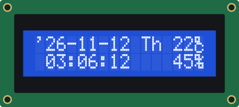
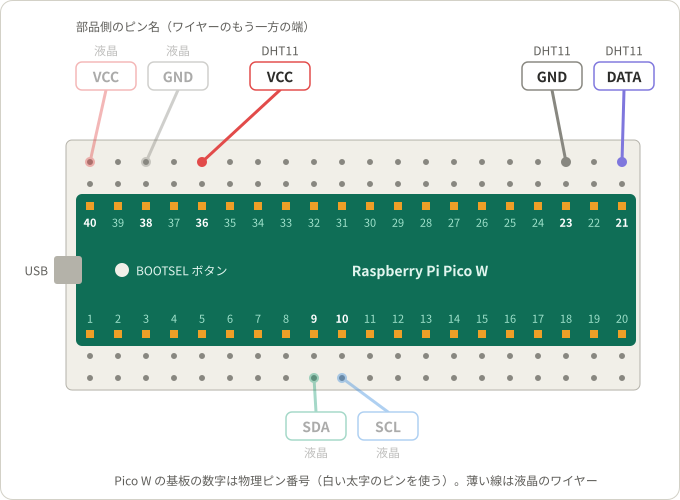

# 室温と湿度も表示する時計

Raspberry Pi Pico W を Wi-Fi につなぎ、インターネットの時刻（NTP）で合わせた日本時間の日付と時刻と、温湿度センサー DHT11 で測った室内の温度と湿度を、I2C LCD1602 に表示する。[project1](../project1/) の時計に DHT11 を加えたものである。



図：液晶の表示の例。1 行目は日付と曜日と温度、2 行目は時刻と湿度。各部分の意味は「[表示の見方](#表示の見方)」にまとめた。

## 準備

初めての場合は、先に次の 3 つを済ませる。

1. [Pico W の準備](../../README.md#pico-w-の準備)：Thonny のインストールと MicroPython の書き込み
2. [LCD1602 の配線](../README.md#配線)と[ライブラリの保存](../README.md#ライブラリを保存する)
3. 2.4 GHz の Wi-Fi の名前（SSID）とパスワードを調べる。Pico W は 5 GHz の Wi-Fi にはつながらない

そのうえで、このページの「[DHT11 の配線](#dht11-の配線)」と「[DHT11 のライブラリを保存する](#dht11-のライブラリを保存する)」を行う。

## DHT11 の配線

DHT11 は、温度と湿度を測ってデジタル信号で送るセンサーである。SunFounder Kepler Kit の DHT11 は、3 本のピン（VCC、GND、DATA）が付いた約 2 cm 角の基板になっている（[キットの解説](https://docs.sunfounder.com/projects/kepler-kit/ja/latest/component/component_humiture.html)）。

LCD1602 の配線に加えて、次のものを使う。

- DHT11（Kepler Kit に入っている基板のもの）
- ジャンパーワイヤー（オス‐メス）3 本

USB ケーブルを抜いた状態で、LCD1602 の配線はそのままにして、DHT11 をつなぐ。



図：Pico W 側のワイヤーの差し込み位置。濃い 3 本が DHT11 のワイヤーで、薄い 4 本は液晶のワイヤーである。

ワイヤーの穴側（メス）を DHT11 のピンにかぶせ、ピン側（オス）を、つなぐピンと同じ縦の列の空いた穴に差す。3 本とも上側の列に差す。ピン名は DHT11 の基板に印刷されている。Pico W の基板の数字は物理ピン番号である（[Pico W のピン](../../README.md#pico-w-のピン)）。

| DHT11 のピン | Pico W のピン | 物理ピン番号 |
|---|---|---|
| VCC | 3V3(OUT) | 36 |
| GND | GND | 23 |
| DATA | GP16 | 21 |

- VCC は 3.3 V につなぐ。DHT11 の電源電圧は 3.3〜5.5 V である（Aosong の DHT11 のデータシート）。DATA の信号は VCC の電圧まで上がるため、5 V につなぐと、3.3 V 用の Pico W のピンの定格を超える。
- 3.3 V で使う場合、データシートはワイヤーの長さを 1 m 以下にするよう求めている。キットのジャンパーワイヤーなら足りる。
- DATA は、キットの例 `6.2_temperature_humidity.py` と同じ GP16 にした。
- GND は、DATA に近い 23 番ピンにした。GND のピンはどれを使ってもよい。

## DHT11 のライブラリを保存する

DHT11 の読み取りには、キットのライブラリ `dht.py` を使う。Pico W に 1 回だけ保存すればよい。キットの「[1.4 Pico にライブラリをアップロード](https://docs.sunfounder.com/projects/kepler-kit/ja/latest/pyproject/python_start/upload_libraries.html)」を済ませていれば、保存済みである。

1. キットのリポジトリの [`libs/dht.py`](https://github.com/sunfounder/kepler-kit/blob/main/libs/dht.py) を開き、右上の「Download raw file」ボタンで PC に保存する。
2. Pico W を USB で PC につなぎ、Thonny で保存したファイルを開く。
3. 「ファイル」→「名前を付けて保存」で「Raspberry Pi Pico」を選び、`dht.py` という名前で保存する。

MicroPython にも `dht` という名前のモジュールが組み込まれているが、使い方が違う。Pico W に `dht.py` を保存すると、組み込みのモジュールより先に `dht.py` が読み込まれる。

## ファイル構成

```
project3/
├── README.md
├── images/
│   ├── display.svg     # 液晶の表示の例
│   └── wiring.svg      # Pico W 側の配線図
└── pico/
    ├── clock_dht11.py  # Pico W で実行するスクリプト
    └── config.py       # Wi-Fi の名前とパスワード（Pico W に保存してから書き換える）
```

## 使い方

### 初回だけ：Wi-Fi の設定を Pico W に保存する

[project1](../project1/) の `config.py` を Pico W に保存済みなら、同じ内容なので、この手順は要らない。

1. Pico W を USB で PC につなぎ、Thonny を開く。
2. Thonny の右下で「MicroPython (Raspberry Pi Pico)」を選ぶ。
3. `pico/config.py` を開き、書き換える前に「ファイル」→「名前を付けて保存」で「Raspberry Pi Pico」を選び、`config.py` という名前で保存する。
4. タブの名前が `[ config.py ]` のように角かっこ付きになり、Pico W 上のファイルを開いた状態になる。ここで `SSID` と `PASSWORD` の値を書き換え、保存する（Ctrl+S）。

リポジトリの `pico/config.py` は書き換えず、Pico W に保存した `config.py` だけにパスワードを書き込む。リポジトリのファイルに書き込むと、誤ってコミットしたときにパスワードが公開されてしまう。

### 毎回：時計を動かす

1. Thonny で `pico/clock_dht11.py` を開き、実行ボタン（F5）を押す。
2. 液晶の表示は、次の順に変わる。

   | 1 行目 | 2 行目 | 状態 |
   |---|---|---|
   | `Wi-Fi...` | Wi-Fi の名前 | Wi-Fi に接続している（最大 20 秒） |
   | `IP address` | `192.168.10.23` など | 接続できた。Pico W の IP アドレスを 3 秒間表示する |
   | `NTP...` | （なし） | NTP サーバーから時刻を受け取っている |
   | `'26-11-12 Th 22℃` | `03:06:12    45%` | 時計と温湿度。時刻は 1 秒ごと、温度と湿度は 5 秒ごとに更新する |

3. 止めるときは停止ボタンを押す。

PC につながず、電源を入れるだけで動かしたい場合は、`clock_dht11.py` を「ファイル」→「名前を付けて保存」で「Raspberry Pi Pico」を選び、`main.py` という名前で保存する。この場合も、`lcd1602.py`、`dht.py`、`config.py` は Pico W に保存しておく。

## 表示の見方

冒頭の図の各部分は、次のとおりである。

| 位置 | 内容 |
|---|---|
| 1 行目の左 | 日付。年は下 2 桁に「'」を付けて示す（`'26` は 2026 年） |
| 1 行目の中央 | 曜日の英語の略称の 2 文字（`Mo`、`Tu`、`We`、`Th`、`Fr`、`Sa`、`Su`） |
| 1 行目の右 | 室温（°C） |
| 2 行目の左 | 時刻（日本時間）。左端に空白を 1 つ入れ、年の数字の列から始める |
| 2 行目の右 | 湿度（%） |

- 温度と湿度は整数で表示する。DHT11 の精度は、温度が ±2 °C、湿度が ±5 %RH である（[キットの解説](https://docs.sunfounder.com/projects/kepler-kit/ja/latest/component/component_humiture.html)）。
- 温度と湿度の数字は、どちらも 14〜15 文字目にそろえている。1 桁のときは前に空白を入れる。
- 起動して最初に測れるまでと、60 秒続けて測れなかったときは、数字の代わりに `--` を表示する。
- 「℃」と「%」は、このプロジェクトで作った文字である（[仕組み](#仕組み)）。

## 表示がおかしいとき

| 液晶の表示・症状 | 確認すること |
|---|---|
| `Wi-Fi failed`、`NTP failed` | project1 の「[表示がおかしいとき](../project1/README.md#表示がおかしいとき)」と同じ |
| 温度と湿度が `--` のまま | DHT11 の 3 本の配線。特に、DATA が 21 番ピン（GP16）、VCC が 36 番ピン（3V3(OUT)）の列に差さっているか |
| `ImportError: can't import name InvalidPulseCount` または `ImportError: no module named 'dht'` | [DHT11 のライブラリ](#dht11-のライブラリを保存する)を Pico W に保存したか。保存していないと、使い方の違う組み込みの `dht` が読み込まれるか、`dht` が見つからない |
| 何も表示されない、ほかの `ImportError` が出る | 部品の README の「[表示されないとき](../README.md#表示されないとき)」 |

## 仕組み

- 時計の部分（NTP で時刻を合わせる、1 時間ごとに合わせ直す、Wi-Fi チップの省電力をオフにする）は、[project1 の仕組み](../project1/README.md#仕組み)と同じである。
- DHT11 は 1 秒に 1 回までしか測れない（DHT11 のデータシート）ため、5 秒ごとに測る。キットの `dht.py` の `measure()` は、失敗すると 5 回まで測り直し、それでも失敗するとエラー `InvalidPulseCount` を出す。このときは前の値を表示し続け、最後に測れてから 60 秒たったら `--` にする。
- 温度と湿度は、`dht.py` が返す値を四捨五入して整数にする。
- 2 行とも 16 文字に収めるため、年を下 2 桁、曜日を 2 文字にした。
- LCD1602 には、自分で作った文字を 8 個まで登録できる。登録先を CGRAM と呼ぶ。起動時に「℃」を 0 番、「%」を 1 番に登録し、文字列の中では `"\x00"` と `"\x01"` と書く。
  - 文字の形は、`clock_dht11.py` の `GLYPHS` に、5 ドット × 8 行の点で書いている。1 行を 5 ビットで表し、1 の点が光る。
  - 「℃」は、液晶の文字 ROM（文字の形を記録したメモリ）にないため作った。
  - 「%」は、文字 ROM の「%」の 2 × 2 ドットの丸を 3 × 3 ドットの輪にして、見やすくした。斜線は文字 ROM の「%」と同じである。
