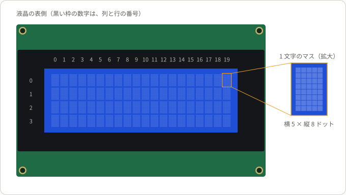
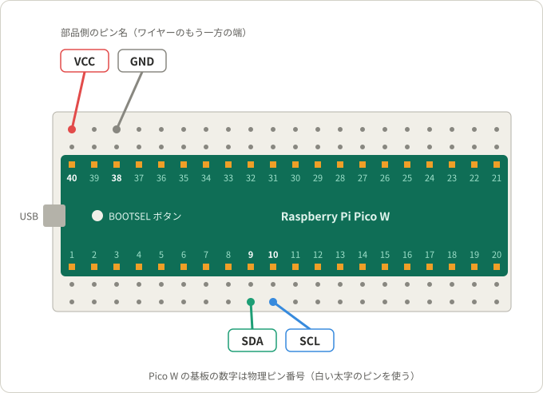
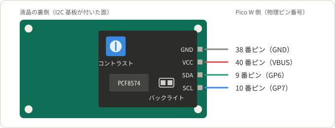

# I2C LCD2004 液晶（20 文字 × 4 行）

20 文字 × 4 行の文字を表示する液晶モジュールを、I2C で Raspberry Pi Pico W につなぐ。I2C は、2 本の信号線（SDA と SCL）で部品と通信する方式である。液晶の裏の I2C 基板は [LCD1602](../lcd1602/) と同じ種類なので、配線とライブラリも LCD1602 と同じである。このディレクトリのプロジェクトは、すべてこのページの配線とライブラリを使う。

図：液晶の表側。文字は、20 列 × 4 行のマスに 1 文字ずつ表示する。黒い枠の数字は列と行の番号で、0 から数える。1 文字は、マスの中の横 5 × 縦 8 ドットの点で表す。

## プロジェクト

| プロジェクト | 内容 |
|---|---|
| [project1](project1/) | 室温と湿度、気圧、気象庁の天気予報も表示する時計（温湿度センサー DHT11 と気圧センサー BMP180 も使う） |

## 必要なもの

- Raspberry Pi Pico W（MicroPython を書き込んだもの。[Pico W の準備](../README.md#pico-w-の準備)を参照）
- I2C LCD2004 モジュール。液晶の裏に I2C 基板（チップ：PCF8574）が付いたもの。例：Youmile の「[IIC/I2C/TWI Serial 2004 20x4 LCD Module](https://www.amazon.co.jp/dp/B084VNTGWX)」
- ブレッドボード
- ジャンパーワイヤー（オス‐メス）4 本

## 配線

LCD1602 の「[配線](../lcd1602/README.md#配線)」と同じである。USB ケーブルを抜いた状態で、次の 2 段階でつなぐ。Pico W は USB 端子を左、部品面を上にして、ブレッドボード中央の溝をまたぐように差しておく。

1. Pico W 側：ワイヤーのピン側（オス）を、つなぐピンと同じ縦の列の空いた穴に差す。VCC と GND は上側、SDA と SCL は下側の列に差す。

   

2. 液晶側：ワイヤーの穴側（メス）を、液晶の裏の I2C 基板のピンにかぶせる。ピン名は、I2C 基板のピンの横に印刷されている。図は LCD1602 のものだが、I2C 基板は同じである。

   

### 配線表

| 液晶のピン | Pico W のピン | 物理ピン番号 |
|---|---|---|
| GND | GND | 38 |
| VCC | VBUS | 40 |
| SDA | GP6 | 9 |
| SCL | GP7 | 10 |

- VCC は 5 V につなぐ。この液晶モジュールの電源電圧は 5 V である。
- 液晶の I2C 基板が SDA と SCL を抵抗で 5 V に引き上げて（プルアップして）いる場合、3.3 V 用の Pico W のピンには、厳密には定格を超える電圧がかかる。LCD1602 と同じく、この配線のまま動かしている。

## ライブラリを保存する

液晶の制御には、LCD1602 と同じキットのライブラリ `lcd1602.py` を使う。LCD1602 の「[ライブラリを保存する](../lcd1602/README.md#ライブラリを保存する)」の手順で、Pico W に保存する。LCD1602 のプロジェクトで保存済みなら、この手順は要らない。液晶の I2C アドレスは基板によって 0x27 か 0x3F で、`lcd1602.py` はどちらも自動で見つける。

`lcd1602.py` は 16 文字 × 2 行の液晶用だが、液晶を動かすチップ（HD44780 互換）は LCD2004 と同じなので、初期化と 1 文字ずつの書き込みはそのまま使える。ただし、`write(列, 行, 文字列)` は、15 より大きい列を 15 に、1 より大きい行を 1 にして書くので、列の番号 16〜19 と行の番号 2〜3 には書けない。そのため、このディレクトリのプロジェクトは `write()` を使わず、次の 2 つで書く。

1. `send_command(0x80 | 番地)` で、書き始める位置を指定する。
2. `send_data(文字コード)` で 1 文字書く。書くたびに、位置は右に 1 つ進む。

番地は、液晶のメモリ（DDRAM）での文字の位置である。各行の左端の番地は次のとおりで、左端から 1 列右に進むごとに 1 増える。

| 行 | 0 | 1 | 2 | 3 |
|---|---|---|---|---|
| 左端の番地 | `0x00` | `0x40` | `0x14` | `0x54` |

0 行目の右端（番地 `0x13`）の次の番地 `0x14` は、2 行目の左端である。そのため、0 行目に 20 文字を超えて書くと、続きは 1 行目ではなく 2 行目に表示される。

## 表示されないとき

| 症状 | 確認すること |
|---|---|
| `ImportError: no module named 'lcd1602'` | [ライブラリ](#ライブラリを保存する)を Pico W に保存したか |
| `ImportError: no module named 'config'` | プロジェクトの README の手順で、`config.py` を Pico W に保存したか |
| `Exception: No LCD found` | SDA・SCL・VCC・GND の配線。SDA と SCL が入れ替わっていないか。Pico W のピンがブレッドボードの奥まで差さっているか |
| 実行中に `OSError: [Errno 5] EIO` が出る | ワイヤーのゆるみ |
| バックライトは光るが文字が見えない、または四角いブロックが並ぶ | 裏の青いつまみ（コントラスト）を、小さなドライバーで回す |
| バックライトが光らない | VCC と GND の配線と、I2C 基板のバックライトのジャンパー（2 本のピンにかぶせる小さな部品）が付いているか |
