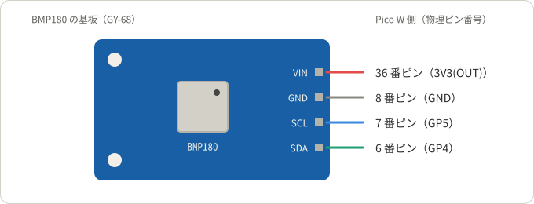

# 室温と湿度、気圧、天気予報も表示する時計

Raspberry Pi Pico W を Wi-Fi につなぎ、インターネットの時刻（NTP）で合わせた日本時間の日付と時刻、温湿度センサー DHT11 で測った室内の温度と湿度、気圧センサー BMP180 で測った気圧、気象庁の今日の天気予報（天気と降水確率）を、I2C LCD2004 に表示する。LCD1602 の [project2](../../lcd1602/project2/) の時計を 20 文字 × 4 行の液晶に移し、気圧と天気予報を加えたものである。


図：液晶の表示の例。1 行目は日付と曜日と温度、2 行目は時刻と湿度、3 行目は今日の天気と気圧、4 行目は今日の 6 時間ごとの降水確率。各部分の意味は「[表示の見方](#表示の見方)」にまとめた。

## 準備

初めての場合は、先に次の 4 つを済ませる。

1. [Pico W の準備](../../README.md#pico-w-の準備)：Thonny のインストールと MicroPython の書き込み
2. [LCD2004 の配線](../README.md#配線)と[ライブラリの保存](../README.md#ライブラリを保存する)
3. DHT11 の[配線](../../lcd1602/project2/README.md#dht11-の配線)と[ライブラリの保存](../../lcd1602/project2/README.md#dht11-のライブラリを保存する)：LCD1602 の project2 と同じ
4. 2.4 GHz の Wi-Fi の名前（SSID）とパスワードを調べる。Pico W は 5 GHz の Wi-Fi にはつながらない
5. 天気予報の地域のコードを調べる（[天気予報の地域を決める](#天気予報の地域を決める)）

そのうえで、このページの「[BMP180 の配線](#bmp180-の配線)」を行う。BMP180 は、ライブラリを使わずにスクリプトの中で読み取るので、ライブラリの保存は要らない。

## BMP180 の配線

BMP180 は、気圧と温度を測ってデジタル信号（I2C）で送るセンサーである。ここでは、BMP180 を GY-68 という小さな基板に載せたモジュールを使う。BMP180 の I2C アドレスは 0x77 である。

LCD2004 と DHT11 の配線に加えて、次のものを使う。

- GY-68 BMP180 モジュール。例：「[EasyWordMall GY-68 BMP180 大気圧センサーモジュール](https://www.amazon.co.jp/dp/B0112A1ZD2)」。ピンヘッダーがはんだ付けされていない場合は、先にはんだ付けする
- ジャンパーワイヤー（オス‐メス）4 本

USB ケーブルを抜いた状態で、LCD2004 と DHT11 の配線はそのままにして、次の 2 段階で BMP180 をつなぐ。

### 1. Pico W 側


図：Pico W 側のワイヤーの差し込み位置。濃い 4 本が BMP180 のワイヤーで、薄い 7 本は液晶と DHT11 のワイヤーである。

ワイヤーのピン側（オス）を、つなぐピンと同じ縦の列の空いた穴に差す。VIN は上側、GND、SCL、SDA は下側の列に差す。VIN を差す 36 番ピンの列には DHT11 の VCC も差してあるので、同じ列の別の穴に差す。Pico W の基板の数字は物理ピン番号である（[Pico W のピン](../../README.md#pico-w-のピン)）。

### 2. BMP180 側



図：BMP180 の基板のピンと Pico W 側の接続先。部品の位置とピンの並びは模式的で、基板によって違うことがある。

ワイヤーの穴側（メス）を、基板のピンにかぶせる。ピン名は、基板に印刷されている。基板によっては、VIN は VCC と印刷されている。「3.3」という 5 本目のピンがある基板では、3.3 には何もつながない。

### 配線表

| BMP180 のピン | Pico W のピン | 物理ピン番号 |
|---|---|---|
| VIN | 3V3(OUT) | 36 |
| GND | GND | 8 |
| SCL | GP5 | 7 |
| SDA | GP4 | 6 |

- BMP180 は、液晶（I2C1）とは別の I2C（I2C0）につなぐ。I2C は、1 組の SDA と SCL に複数の部品をつなげる。しかし、液晶の I2C 基板が SDA と SCL を 5 V に引き上げている場合、同じ線につなぐと、BMP180 の SDA と SCL にも 3.3 V を超える電圧がかかる。BMP180 のチップが動作する電源電圧は 1.8〜3.6 V なので（Bosch の BMP180 のデータシート）、その範囲を超える電圧は避ける。
- VIN は 3.3 V につなぐ。電源を整える部品（レギュレーター）がない基板でも、3.3 V ならチップの電源電圧に収まる。また、基板が SDA と SCL を引き上げる電圧も 3.3 V 以下になる。
- SDA と SCL は、I2C0 に使えるピンのうち、液晶の SDA と SCL（9、10 番ピン）に近い GP4 と GP5（6、7 番ピン）にした。GND は、その隣の 8 番ピンにした。GND のピンはどれを使ってもよい。

## ファイル構成

```
project1/
├── README.md
├── images/
│   ├── bmp180-pins.svg                # BMP180 のピンと Pico W 側の接続先
│   ├── display.svg                    # 液晶の表示の例
│   └── wiring.svg                     # Pico W 側の配線図
└── pico/
    ├── clock_dht11_bmp180_lcd2004.py  # Pico W で実行するスクリプト
    └── config.py                      # Wi-Fi の名前とパスワード、天気予報の地域（Pico W に保存してから書き換える）
```

## 天気予報の地域を決める

天気予報は、気象庁が発表する府県天気予報を使う。府県天気予報は、府県予報区（多くは都府県。北海道と沖縄県は、さらにいくつかに分かれる）を 1〜4 つの地域に分けた一次細分区域ごとに発表される。地域は、`config.py` に次の 2 つのコード（どちらも 6 桁）で指定する。

| 名前 | 意味 | 例 |
|---|---|---|
| `JMA_OFFICE` | 府県予報区のコード。この地域の予報のファイルを選ぶ | `"130000"`（東京都） |
| `JMA_AREA` | 一次細分区域のコード。ファイルの中から、この地域の予報を選ぶ | `"130010"`（東京地方） |

コードは、次の手順で調べる。

1. 気象庁の「[細分区域等一覧表](https://www.jma.go.jp/jma/kishou/know/yougo_hp/shichoson_ichiran.html)」で、住んでいる市町村が入る府県予報区と一次細分区域の名前を調べる。例えば、千代田区は府県予報区「東京都」の一次細分区域「東京地方」に入る。
2. 気象庁の地域のコードの一覧（[area.json](https://www.jma.go.jp/bosai/common/const/area.json)）をブラウザで開き、ページ内検索で一次細分区域の名前を探す。`class10s` の中に、`"130010":{"name":"東京地方", …, "parent":"130000", …}` のように書かれている。先頭の 6 桁（`130010`）が `JMA_AREA`、`parent` の 6 桁（`130000`）が `JMA_OFFICE` である。
3. 「北部」のように、同じ名前の一次細分区域がいくつも見つかる場合は、`parent` が自分の府県予報区のものを選ぶ。府県予報区のコードは、`offices` の中で府県予報区の名前（例：東京都）を探すと分かる。

`parent` が `014030`（十勝地方）か `460040`（奄美地方）の場合は、`JMA_OFFICE` をそれぞれ `014100`、`460100` にする。この 2 つの地域の予報は、それぞれ釧路・根室地方と鹿児島県の予報のファイルに入っている。

## 使い方

### 初回だけ：Wi-Fi と天気予報の地域の設定を Pico W に保存する

LCD1602 のプロジェクトの `config.py` を Pico W に保存済みなら、Thonny でその `config.py` を開き、[`pico/config.py`](pico/config.py) の最後の 3 行（`JMA_OFFICE` と `JMA_AREA`）を書き足して保存する。保存していなければ、次の手順で保存する。

1. Pico W を USB で PC につなぎ、Thonny を開く。
2. Thonny の右下で「MicroPython (Raspberry Pi Pico)」を選ぶ。
3. [`pico/config.py`](pico/config.py) を開き、書き換える前に「ファイル」→「名前を付けて保存」で「Raspberry Pi Pico」を選び、`config.py` という名前で保存する。
4. タブの名前が `[ config.py ]` のように角かっこ付きになり、Pico W 上のファイルを開いた状態になる。ここで `SSID`、`PASSWORD`、`JMA_OFFICE`、`JMA_AREA` の値を書き換え、保存する（Ctrl+S）。

リポジトリの `pico/config.py` は書き換えず、Pico W に保存した `config.py` だけにパスワードを書き込む。リポジトリのファイルに書き込むと、誤ってコミットしたときにパスワードが公開されてしまう。

### 毎回：時計を動かす

1. Thonny で [`pico/clock_dht11_bmp180_lcd2004.py`](pico/clock_dht11_bmp180_lcd2004.py) を開き、実行ボタン（F5）を押す。
2. 液晶の表示は、次の順に変わる。時計になるまで、3 行目と 4 行目は空白である。

   | 1 行目 | 2 行目 | 状態 |
   |---|---|---|
   | `Wi-Fi...` | Wi-Fi の名前 | Wi-Fi に接続している（最大 20 秒） |
   | `IP address` | `192.168.10.23` など | 接続できた。Pico W の IP アドレスを 3 秒間表示する |
   | `NTP...` | （なし） | NTP サーバーから時刻を受け取っている |
   | ` 2026-11-12 Thu  22℃` | ` AM10:06:12      45%` | 時計と温湿度、天気と気圧（3 行目）、降水確率（4 行目）。時刻は 1 秒ごと、温度と湿度と気圧は 5 秒ごと、天気予報は 30 分ごとに更新する |

   時計になった直後に、天気予報を取りに行く。取り終わるまでの数秒間は、時計の表示が止まる。30 分ごとに取り直すときも同じである。

3. 止めるときは停止ボタンを押す。

PC につながず、電源を入れるだけで動かしたい場合は、`clock_dht11_bmp180_lcd2004.py` を「ファイル」→「名前を付けて保存」で「Raspberry Pi Pico」を選び、`main.py` という名前で保存する。この場合も、`lcd1602.py`、`dht.py`、`config.py` は Pico W に保存しておく。

## 表示の見方

冒頭の図の各部分は、次のとおりである。

| 位置 | 内容 |
|---|---|
| 1 行目の左 | 日付と、曜日の英語の略称の 3 文字（`Mon`、`Tue`、`Wed`、`Thu`、`Fri`、`Sat`、`Sun`） |
| 1 行目の右 | 室温（°C）。DHT11 で測る |
| 2 行目の左 | 時刻（日本時間）。12 時間制で、前に `AM`（0〜11 時台）か `PM`（12〜23 時台）を付ける。0 時台と 12 時台は `12` と表示する。「:」を、日付の「-」と同じ列にそろえる |
| 2 行目の右 | 湿度（%）。DHT11 で測る |
| 3 行目の左 | 今日の天気。`Sunny`（晴れ）、`Cloudy`（くもり）、`Rain`（雨）、`Snow`（雪）のどれか |
| 3 行目の右 | 気圧（hPa）。BMP180 で測る |
| 4 行目 | 傘の印と、今日の降水確率（%）。左から 0〜6 時、6〜12 時、12〜18 時、18〜24 時 |

- どの行も、左端の 1 文字は空けている。起動中の表示（`Wi-Fi...` など）も同じである。
- 温度、湿度、気圧、降水確率は、どれも右端の列にそろえている。
- 天気は、気象庁の予報の主な天気だけを表示する。例えば「晴れ時々くもり」は `Sunny` になる。「時々」や「のち」の後の天気は、降水確率から読み取る。
- 降水確率は、過ぎた時間帯には予報がないので `--` になる。例えば図の 10 時ごろの表示では、0〜6 時が `--` である。天気予報を一度も取れていないときは、天気も降水確率もすべて `--` になる。
- 温度と湿度は整数で表示する。DHT11 の精度は、LCD1602 の project2 の「[表示の見方](../../lcd1602/project2/README.md#表示の見方)」のとおりである。
- 気圧は、BMP180 を置いた場所の気圧（現地気圧）である。天気予報や天気図の気圧は、標高 0 m での値に換算した気圧（海面気圧）なので、標高が高い場所ほど表示より大きい。海面に近い高さでは、標高が 10 m 上がるごとに、気圧は約 1.2 hPa 下がる。
- BMP180 の気圧の誤差は、−4.0〜+2.0 hPa である（0〜65 °C、BMP180 のデータシート）。一方、温度が同じときに測った 2 つの気圧の差の誤差（相対精度）は ±0.12 hPa（950〜1050 hPa、25 °C）と小さい。そのため、表示の値そのものより、気圧の上がり下がりを見るのに向く。
- 起動して最初に測れるまでと、60 秒続けて測れなかったときは、数字の代わりに `--` を表示する。`--` にするかどうかは、DHT11（温度と湿度）と BMP180（気圧）で別々に判断する。
- 「℃」と「%」は、LCD1602 の project2 と同じく、自分で作った文字である（[project2 の仕組み](../../lcd1602/project2/README.md#仕組み)）。4 行目の傘と、`AM` の A も、同じ方法で作った。A は、横線を文字 ROM の A より 1 段上げた形にした。

## 表示がおかしいとき

| 液晶の表示・症状 | 確認すること |
|---|---|
| `BMP180 not found` | BMP180 の 4 本の配線。特に、SDA が 6 番ピン（GP4）、SCL が 7 番ピン（GP5）、VIN が 36 番ピン（3V3(OUT)）の列に差さっているか。SDA と SCL が入れ替わっていないか |
| 気圧が `--` になる | BMP180 のワイヤーのゆるみ |
| 気圧が天気予報の気圧より小さい | 故障ではない。表示は現地気圧である（[表示の見方](#表示の見方)） |
| 天気と降水確率が `--` のまま | Thonny の「シェル」に出る `forecast:` の行で原因を確かめる。`HTTP 404` なら `JMA_OFFICE` が、`JMA_AREA ... not found` なら `JMA_AREA` が違う（[天気予報の地域を決める](#天気予報の地域を決める)）。そのほかの `OSError` や `ValueError` は通信の失敗で、30 分後に取り直す。続く場合は、MicroPython を最新にする |
| `AttributeError` で `JMA_OFFICE` が出る | Pico W の `config.py` に、`JMA_OFFICE` と `JMA_AREA` を書き足す（[使い方](#初回だけwi-fi-と天気予報の地域の設定を-pico-w-に保存する)） |
| `Wi-Fi failed`、`NTP failed` | LCD1602 の project1 の「[表示がおかしいとき](../../lcd1602/project1/README.md#表示がおかしいとき)」と同じ |
| 温度と湿度が `--` のまま、`dht` の `ImportError` が出る | LCD1602 の project2 の「[表示がおかしいとき](../../lcd1602/project2/README.md#表示がおかしいとき)」と同じ |
| 何も表示されない、ほかの `ImportError` が出る | 部品の README の「[表示されないとき](../README.md#表示されないとき)」 |

## 仕組み

- 時計の部分は [LCD1602 の project1 の仕組み](../../lcd1602/project1/README.md#仕組み)と、DHT11 の部分は [LCD1602 の project2 の仕組み](../../lcd1602/project2/README.md#仕組み)と同じである。
- 液晶には、部品の README の「[ライブラリを保存する](../README.md#ライブラリを保存する)」のとおり、`send_command()` で各行の左端の番地を指定し、`send_data()` で 1 文字ずつ書く。
- `lcd1602.py` は 1 文字書くたびに 4 ms 待つので、1 文字の書き込みに約 5 ms かかる。4 行（80 文字）を書き直すと約 0.4 秒かかるため、前回と変わった行だけ書き直す。毎秒書き直すのは、時刻の 2 行目だけである。
- BMP180 は、ライブラリを使わず、[`clock_dht11_bmp180_lcd2004.py`](pico/clock_dht11_bmp180_lcd2004.py) の中で、BMP180 のデータシートの手順のとおりに読み取る。
  1. 起動時に、BMP180 ごとに工場で書き込まれた補正の係数（11 個）を読む。
  2. 5 秒ごとに、温度の生の値を測り、続けて気圧の生の値を測る。
  3. `pascal()` で、生の値と補正の係数から気圧（Pa）を計算する。計算には温度の生の値も使う。
- `pascal()` の計算は、起動時に、データシートの計算例（係数と生の値から 69964 Pa になる）と一致することを `assert` で確かめている。
- 気圧は、`OSS = 3`（データシートの ultra high resolution）で測る。BMP180 の中で 8 回測った平均で、1 回の測定に最大 25.5 ms かかる。ばらつき（RMS ノイズ）は約 0.03 hPa で、表示の最小の桁（0.1 hPa）より小さい。
- BMP180 も温度を測るが、表示する温度は、LCD1602 の project2 と同じく DHT11 の値にした。BMP180 の温度は、気圧の計算にだけ使う。
- 天気予報は、気象庁のホームページが予報の表示に使う JSON のファイル `https://www.jma.go.jp/bosai/forecast/data/forecast/<JMA_OFFICE>.json` から読む（出典：気象庁ホームページ）。API キーは要らない。このファイルはホームページの表示用で、形式が変わると読み取れなくなることがある。
- ファイルの最初の要素の `timeSeries` のうち、0 番から天気コード（`weatherCodes`）を、1 番から 6 時間ごとの降水確率（`pops`）を、`JMA_AREA` の地域の分だけ取り出す。天気コードは 3 桁の数字で、1 桁目が主な天気（1：晴れ、2：くもり、3：雨、4：雪）を表す。
- 取り出した予報は、日付や時刻と組にして覚えておき、表示のたびに今日の日付の分を選ぶ。そのため、取り直す前に日付が変わっても、前の日の 17 時の予報にある今日の分を表示できる。
- 気象庁は、府県天気予報を 5 時、11 時、17 時に発表する。このスクリプトは 30 分ごとに取り直すので、発表から 30 分以内に表示が新しくなる。取り直しに失敗したときは、前の予報を使い続ける。
- 取得には、MicroPython の Pico W 用のファームウェアに入っている `requests` を使う。取得中は表示の処理が止まるため、数秒間、時計の秒が進まない。
