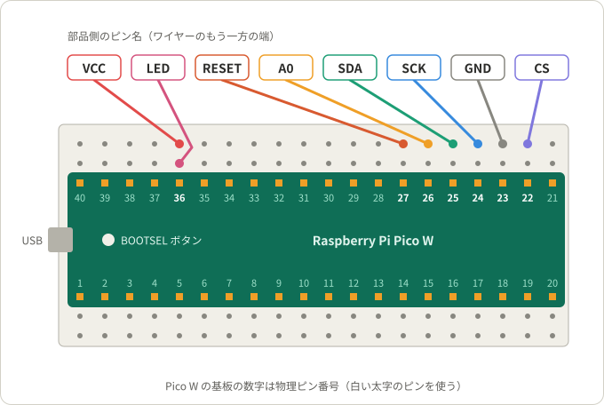
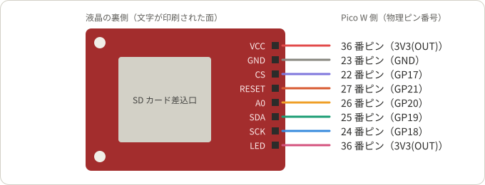

# ST7735 液晶（1.8 インチ TFT）

1.8 インチの SPI 液晶モジュール（ドライバ IC：ST7735、128×160 ピクセル）を Raspberry Pi Pico W につなぐ。このディレクトリのプロジェクトは、すべてこのページの配線を使う。

## プロジェクト

| プロジェクト | 内容 |
|---|---|
| [project1](project1/) | 表示デモ。配線の確認にも使う |
| [project2](project2/) | PC 画面のミラー表示 |

## 必要なもの

- Raspberry Pi Pico W（MicroPython を書き込んだもの。[Pico W の準備](../README.md#pico-w-の準備)を参照）
- 1.8 インチ SPI 液晶モジュール（ドライバ IC：ST7735、128×160 ピクセル）。裏に「1.8 TFT SPI 128*160 V1.1」と印刷されたもの
- ブレッドボード
- ジャンパーワイヤー（オス‐メス）8 本

## 配線

USB ケーブルを抜いた状態で、次の 2 段階でつなぐ。Pico W は USB 端子を左、部品面を上にして、ブレッドボード中央の溝をまたぐように差しておく。

### 1. Pico W 側

ワイヤーのピン側（オス）を、つなぐピンと同じ縦の列の空いた穴に差す。Pico W の基板の数字は物理ピン番号である（[Pico W のピン](../README.md#pico-w-のピン)）。36 番ピンの列には VCC と LED の 2 本を差す。同じ列なら、どの穴に差してもよい。

### 2. 液晶側

ワイヤーの穴側（メス）を、液晶の裏のピンにかぶせる。ピン名は液晶の裏の右端に印刷されている。

### 配線表

| 液晶のピン | Pico W のピン | 物理ピン番号 |
|---|---|---|
| VCC | 3V3(OUT) | 36 |
| GND | GND | 23 |
| CS | GP17 | 22 |
| RESET | GP21 | 27 |
| A0 | GP20 | 26 |
| SDA | GP19 | 25 |
| SCK | GP18 | 24 |
| LED | 3V3(OUT) | 36 |

## 表示されないとき

配線を確かめるには、[project1](project1/) の表示デモを動かす。

| 症状 | 確認すること |
|---|---|
| 画面が真っ白のまま | CS・RESET・A0・SDA・SCK の配線 |
| 画面がまったく光らない | VCC・GND・LED の配線 |
| 実行すると画面全体が暗くなり、停止すると明るくなる | 配線のずれ。LED の線が 3V3(OUT) 以外の列に入っている可能性が高い |

色の順序や表示の向きがおかしい場合は、各プロジェクトの README を見る。
