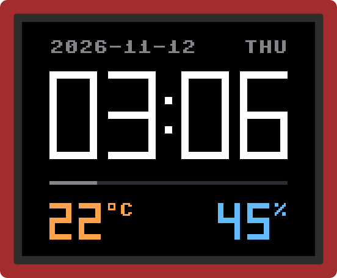
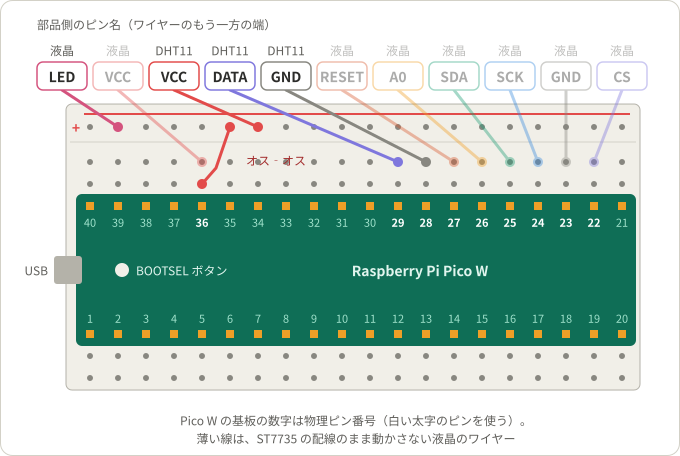
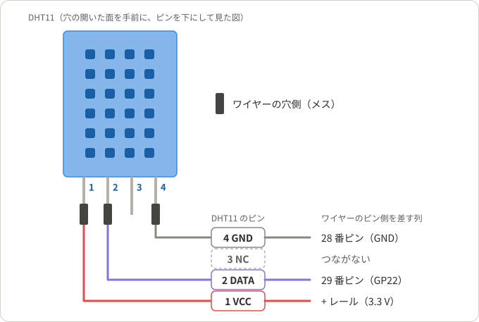

# 室温と湿度も表示する時計

Raspberry Pi Pico W を Wi-Fi につなぎ、インターネットの時刻（NTP）で合わせた日本時間の日付と時刻と、温湿度センサー DHT11 で測った室内の温度と湿度を、1.8 インチの ST7735 液晶に表示する。液晶は横向き（160×128 ピクセル）で使う。LCD1602 の「[室温と湿度も表示する時計](../../lcd1602/project2/)」（以下、LCD1602 版）と同じものを、カラー液晶に合わせた表示にした。



図：液晶の表示の例。各部分の意味は「[表示の見方](#表示の見方)」にまとめた。

## 準備

初めての場合は、先に次の 3 つを済ませる。

1. [Pico W の準備](../../README.md#pico-w-の準備)：Thonny のインストールと MicroPython の書き込み
2. [ST7735 の配線](../README.md#配線)。配線が正しいかは [project1](../project1/) の表示デモで確かめられる
3. 2.4 GHz の Wi-Fi の名前（SSID）とパスワードを調べる。Pico W は 5 GHz の Wi-Fi にはつながらない

そのうえで、このページの「[DHT11 の配線](#dht11-の配線)」と「[DHT11 のライブラリを保存する](#dht11-のライブラリを保存する)」を行う。

## DHT11 の配線

DHT11 は、温度と湿度を測ってデジタル信号で送るセンサーである。SunFounder Kepler Kit の DHT11 は、穴の開いた青い本体から 4 本のピンが出た部品で、そのうち 3 本（VCC、DATA、GND）を使う（[キットの解説](https://docs.sunfounder.com/projects/kepler-kit/ja/latest/component/component_humiture.html)）。

ST7735 の配線に加えて、次のものを使う。

- DHT11（Kepler Kit に入っているもの）
- ジャンパーワイヤー（オス‐メス）3 本
- ジャンパーワイヤー（オス‐オス）1 本

DATA と GND は、LCD1602 版と同じピンにつなぐ。VCC も同じく 3V3(OUT)（36 番ピン）の 3.3 V につなぐが、ST7735 の配線では、36 番ピンの列の空いた穴 2 つを、液晶の VCC と LED で使い切っている。そこで、ブレッドボードの端にある + レール（赤い線に沿って横に並んだ穴の列で、穴どうしが中で横につながっている）に 3.3 V を出し、液晶の LED と DHT11 の VCC をそこに差す。

USB ケーブルを抜いた状態で、次の 2 段階でつなぐ。

### 1. Pico W 側



図：Pico W 側のワイヤーの差し込み位置。濃い線が、差し替えるワイヤーと新しく足すワイヤーで、薄い 7 本は ST7735 の配線のまま動かさない液晶のワイヤーである。

1. 液晶の LED のワイヤーを 36 番ピンの列から抜き、+ レールに差す。
2. オス‐オスのジャンパーワイヤーで、36 番ピンの列の空いた穴と + レールをつなぐ。
3. DHT11 の 3 本のワイヤーのピン側（オス）を差す。VCC は + レール、DATA は 21 番ピンの列、GND は 23 番ピンの列の空いた穴に差す。23 番ピンの列には液晶の GND も差してあるが、穴は 1 つ空いている。

+ レールが真ん中で左右に分かれているブレッドボードもあるため、+ レールに差す 3 本は、図のように近くの穴にまとめる。Pico W の基板の数字は物理ピン番号である（[Pico W のピン](../../README.md#pico-w-のピン)）。

### 2. DHT11 側



図：DHT11 のピンとつなぐ先。黒い四角はワイヤーの穴側（メス）である。穴の並びは模式的である。

DHT11 にはピン名が書かれていないので、ピンは向きで見分ける。穴の開いた面を手前に、ピンを下にして持つと、ピンは左から 1、2、3、4 番である。ワイヤーの穴側（メス）を 1、2、4 番のピンにかぶせる。3 番（NC）は中で何にもつながっていないピンなので、空けておく。

### 配線表

| ワイヤー | 一方の端 | もう一方の端 | 物理ピン番号 |
|---|---|---|---|
| オス‐オス（新しく足す） | 3V3(OUT) の列 | + レール | 36 |
| 液晶の LED（差し替える） | 液晶の LED | + レール | － |
| DHT11 の VCC | DHT11 の 1 番 | + レール | － |
| DHT11 の DATA | DHT11 の 2 番 | GP16 の列 | 21 |
| DHT11 の GND | DHT11 の 4 番 | GND の列 | 23 |

DHT11 の 3 番（NC）には何もつながない。液晶のほかの 7 本は、[ST7735 の配線表](../README.md#配線表)のままである。

- VCC は 3.3 V につなぐ。DHT11 の電源電圧は 3.3〜5.5 V である（Aosong の DHT11 のデータシート）。3.3 V にすれば、DATA の電圧も、3.3 V 用の Pico W のピンの定格を超えない。
- 抵抗は付けない。キットのライブラリ `dht.py` は、DATA を読むときに Pico W の中のプルアップ抵抗を使う。
- 3.3 V で使う場合、データシートはワイヤーの長さを 1 m 以下にするよう求めている。キットのジャンパーワイヤーなら足りる。
- DATA は、キットの例 `6.2_temperature_humidity.py` や LCD1602 版と同じ GP16 にした。GP16 は、MicroPython の `SPI(0, ...)` が MISO（部品から Pico W へデータを送る線）に割り当てるピンでもある。液晶からはデータを受け取らないので、スクリプトで普通の入力ピンに設定し直して使う。
- GND は、LCD1602 版と同じ 23 番ピンにした。GND のピンはどれを使ってもよい。

## DHT11 のライブラリを保存する

DHT11 の読み取りには、キットのライブラリ `dht.py` を使う。Pico W に 1 回だけ保存すればよい。キットの「[1.4 Pico にライブラリをアップロード](https://docs.sunfounder.com/projects/kepler-kit/ja/latest/pyproject/python_start/upload_libraries.html)」や、LCD1602 版の手順を済ませていれば、保存済みである。

1. キットのリポジトリの [`libs/dht.py`](https://github.com/sunfounder/kepler-kit/blob/main/libs/dht.py) を開き、右上の「Download raw file」ボタンで PC に保存する。
2. Pico W を USB で PC につなぎ、Thonny で保存したファイルを開く。
3. 「ファイル」→「名前を付けて保存」で「Raspberry Pi Pico」を選び、`dht.py` という名前で保存する。

MicroPython にも `dht` という名前のモジュールが組み込まれているが、使い方が違う。Pico W に `dht.py` を保存すると、組み込みのモジュールより先に `dht.py` が読み込まれる。

## ファイル構成

```
project3/
├── README.md
├── images/
│   ├── dht11-pins.svg         # DHT11 のピンとつなぐ先
│   ├── display.svg            # 液晶の表示の例
│   └── wiring.svg             # Pico W 側の配線図
└── pico/
    ├── clock_dht11_st7735.py  # Pico W で実行するスクリプト
    └── config.py              # Wi-Fi の名前とパスワード（Pico W に保存してから書き換える）
```

## 使い方

### 初回だけ：Wi-Fi の設定を Pico W に保存する

LCD1602 の時計の `config.py` を Pico W に保存済みなら、同じ内容なので、この手順は要らない。

1. Pico W を USB で PC につなぎ、Thonny を開く。
2. Thonny の右下で「MicroPython (Raspberry Pi Pico)」を選ぶ。
3. `pico/config.py` を開き、書き換える前に「ファイル」→「名前を付けて保存」で「Raspberry Pi Pico」を選び、`config.py` という名前で保存する。
4. タブの名前が `[ config.py ]` のように角かっこ付きになり、Pico W 上のファイルを開いた状態になる。ここで `SSID` と `PASSWORD` の値を書き換え、保存する（Ctrl+S）。

リポジトリの `pico/config.py` は書き換えず、Pico W に保存した `config.py` だけにパスワードを書き込む。リポジトリのファイルに書き込むと、誤ってコミットしたときにパスワードが公開されてしまう。

### 毎回：時計を動かす

1. Thonny で `pico/clock_dht11_st7735.py` を開き、実行ボタン（F5）を押す。
2. 液晶の表示は、次の順に変わる。

   | 上の行 | 下の行 | 状態 |
   |---|---|---|
   | `Wi-Fi...` | Wi-Fi の名前 | Wi-Fi に接続している（最大 20 秒） |
   | `IP address` | `192.168.10.23` など | 接続できた。Pico W の IP アドレスを 3 秒間表示する |
   | `NTP...` | （なし） | NTP サーバーから時刻を受け取っている |
   | 冒頭の図の画面 | | 時計と温湿度。時刻は 1 秒ごと、温度と湿度は 5 秒ごとに更新する |

3. 止めるときは停止ボタンを押す。

PC につながず、電源を入れるだけで動かしたい場合は、`clock_dht11_st7735.py` を「ファイル」→「名前を付けて保存」で「Raspberry Pi Pico」を選び、`main.py` という名前で保存する。[project2](../project2/) の受信側を `main.py` として保存していた場合は、上書きされる。この場合も、`dht.py` と `config.py` は Pico W に保存しておく。

## 表示の見方

冒頭の図の各部分は、次のとおりである。

| 位置 | 内容 |
|---|---|
| 上 | 日付（年-月-日）と、曜日の英語の略称の 3 文字（`MON`、`TUE`、`WED`、`THU`、`FRI`、`SAT`、`SUN`） |
| 中央 | 時刻（日本時間の時と分、24 時間制） |
| 時刻の下の線 | 秒。明るい部分が、毎分 0 秒に左端から伸び始め、59 秒で右端に届く |
| 左下（オレンジ色） | 室温（°C） |
| 右下（青色） | 湿度（%） |

- 温度と湿度は整数で表示する。DHT11 の精度は、温度が ±2 °C、湿度が ±5 %RH である（[キットの解説](https://docs.sunfounder.com/projects/kepler-kit/ja/latest/component/component_humiture.html)）。
- 起動して最初に測れるまでと、60 秒続けて測れなかったときは、数字の代わりに `--` を表示する。

## 表示がおかしいとき

| 液晶の表示・症状 | 確認すること |
|---|---|
| `Wi-Fi failed`、`NTP failed` | LCD1602 の時計の「[表示がおかしいとき](../../lcd1602/project1/README.md#表示がおかしいとき)」と同じ |
| 温度と湿度が `--` のまま | DHT11 の 3 本の配線。特に、DATA が 21 番ピン（GP16）の列に差さっているか、オス‐オスのワイヤーで 36 番ピンの列と + レールをつないだか。DHT11 側で、ワイヤーを 3 番（NC）ではなく 1、2、4 番のピンにかぶせているか |
| 画面がまったく光らない | 液晶の LED のワイヤーを + レールに差したか、オス‐オスのワイヤーで 36 番ピンの列と + レールをつないだか。+ レールに差した 3 本が、レールの切れ目をまたいでいないか |
| `ImportError: can't import name InvalidPulseCount` または `ImportError: no module named 'dht'` | [DHT11 のライブラリ](#dht11-のライブラリを保存する)を Pico W に保存したか。保存していないと、使い方の違う組み込みの `dht` が読み込まれるか、`dht` が見つからない |
| 温度が青く、湿度がオレンジ色に見える | `clock_dht11_st7735.py` の `b"\xA0"` を `b"\xA8"` に変える。赤と青が入れ替わって表示される液晶である |
| 上下が逆さに映る | `b"\xA0"` を `b"\x60"` に変える。赤と青も入れ替わっている場合は `b"\x68"` にする |
| 画面の端に 1〜2 px のノイズが出る | `X0, Y0 = 0, 0` を `1, 2` に変える |
| 画面が真っ白のまま、ほかの `ImportError` が出る | 部品の README の「[表示されないとき](../README.md#表示されないとき)」 |

## 仕組み

- 時計の部分（NTP で時刻を合わせる、1 時間ごとに合わせ直す、Wi-Fi チップの省電力をオフにする）は、LCD1602 の時計の「[仕組み](../../lcd1602/project1/README.md#仕組み)」と同じである。
- DHT11 の測り方も、LCD1602 版の「[仕組み](../../lcd1602/project2/README.md#仕組み)」と同じである。5 秒ごとに測り、測れなかったときは前の値を表示し続け、最後に測れてから 60 秒たったら `--` にする。
- 画面は、MicroPython の `framebuf` で 160×128 ピクセルの画像を作り、1 秒ごとに全体を描き直して液晶に送る。
- 時刻と温湿度の数字は、7 本の棒（上、右上、右下、下、左下、左上、中央）の組み合わせで描く。どの棒を光らせるかは、`clock_dht11_st7735.py` の `SEGMENTS` に書いている。「1」だけは、右の 2 本で描くと左が大きく空くため、真ん中の縦棒と左上の短い横棒で描く。
- 日付、曜日、「C」は、`framebuf` に組み込まれた 8×8 ピクセルの文字で書く。
  - 「°」は、この文字にないため、4×4 ピクセルの四角い枠で描く。
  - 「%」は、この文字の「%」の 2×2 ピクセルの点を、中が空いた 3×3 ピクセルの輪にして、見やすくした。斜線は、この文字の「%」と同じである。
